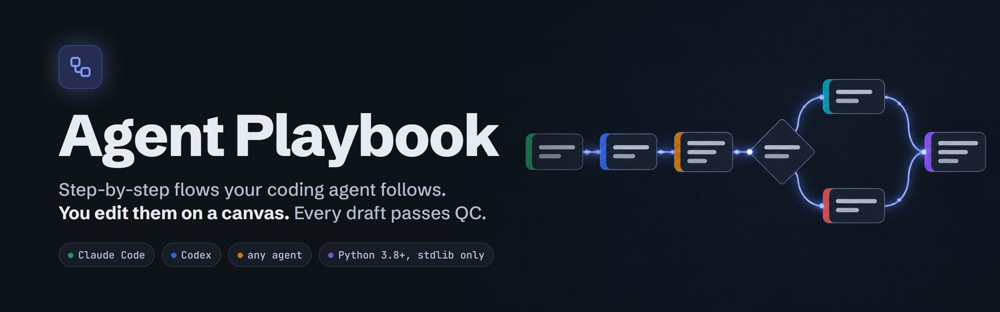
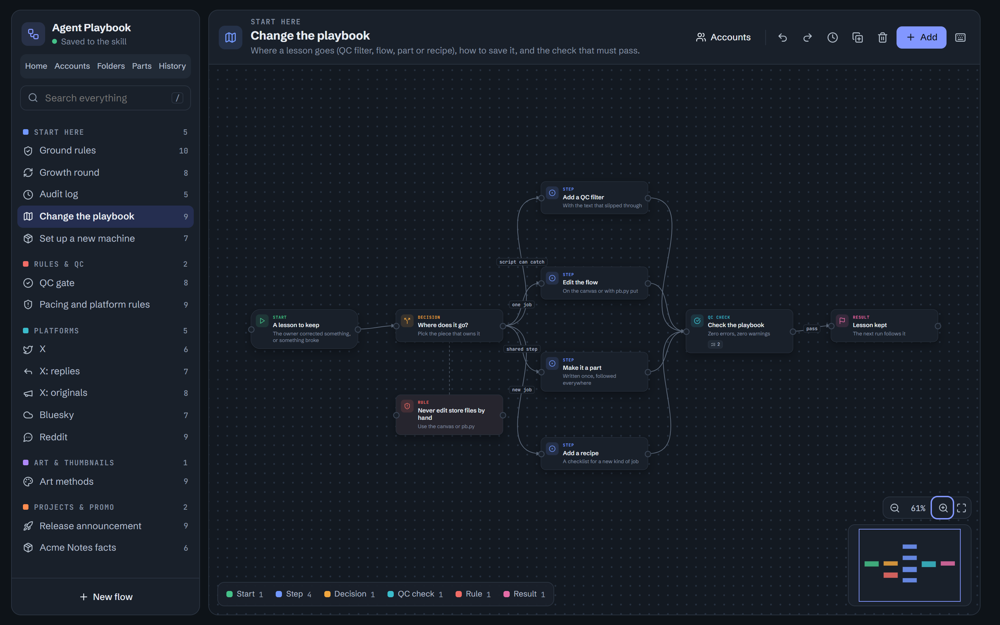
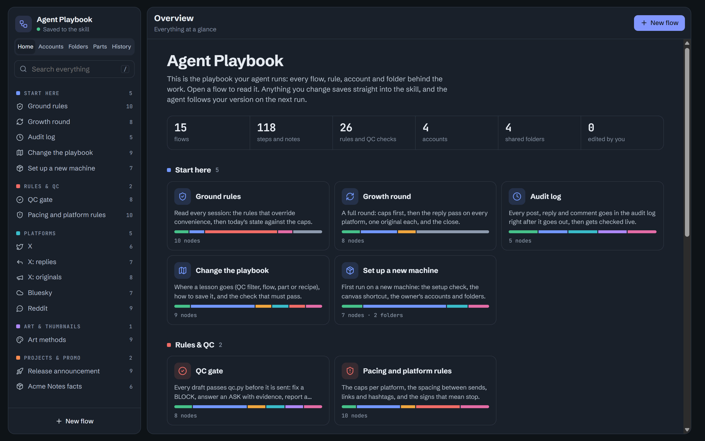
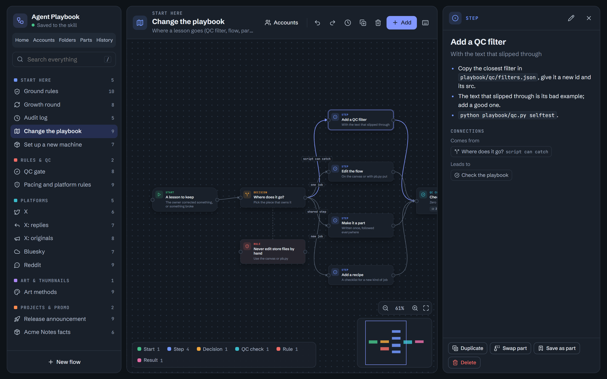
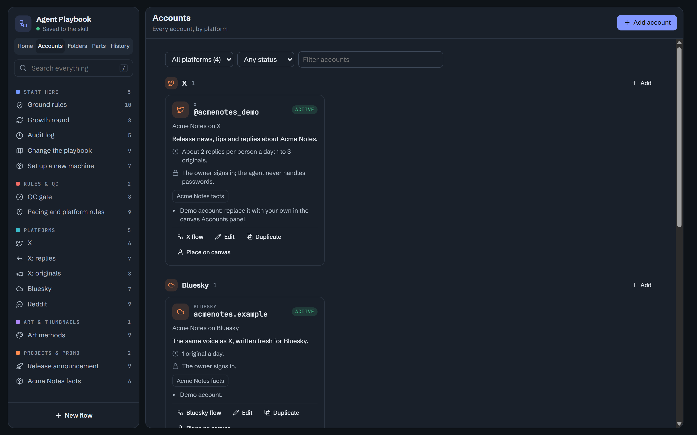
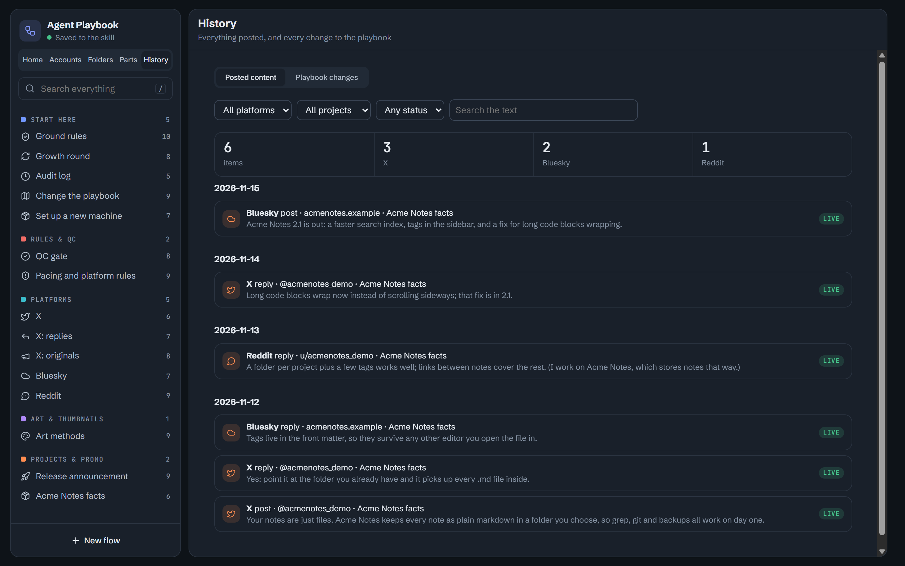
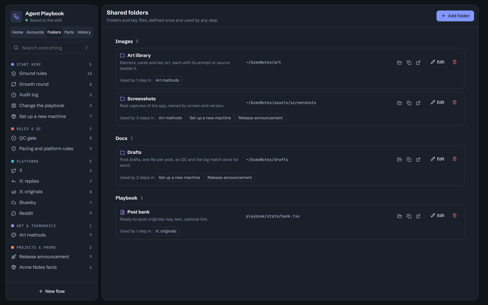
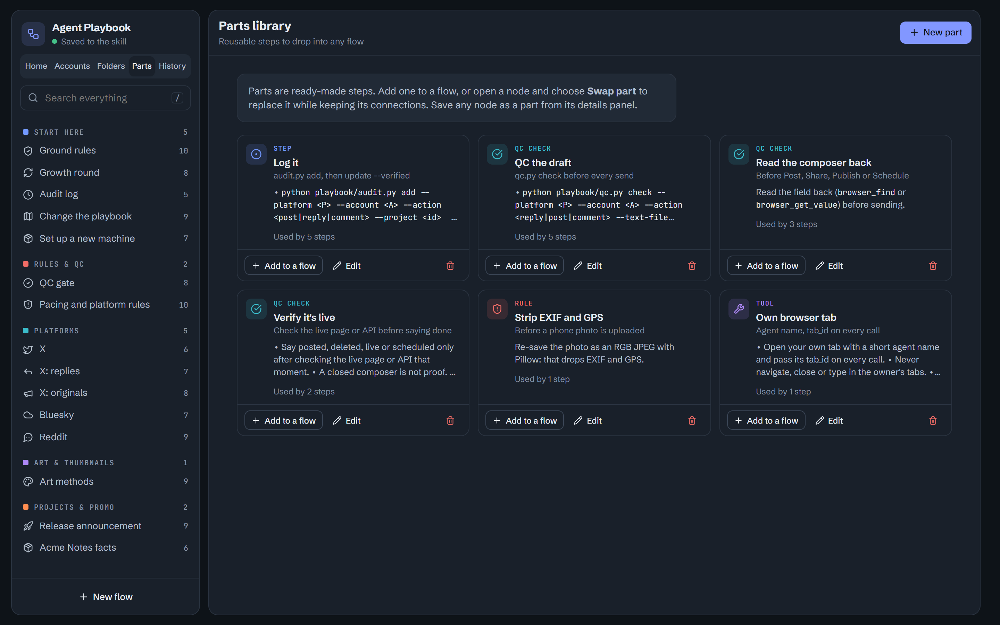
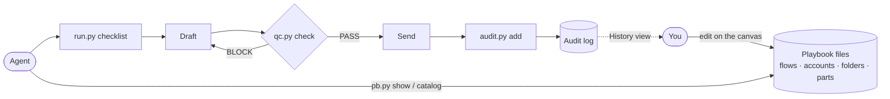

<p align="center">
  
</p>

<p align="center">
  <a href="https://github.com/RandyNorthrup/agent-playbook/actions/workflows/ci.yml"></a>
  <a href="LICENSE"></a>
  
  
  
</p>

<p align="center">
  <a href="#quick-start">Quick start</a> ·
  <a href="#a-tour">Tour</a> ·
  <a href="#how-an-agent-uses-it">How an agent uses it</a> ·
  <a href="#make-it-yours">Make it yours</a> ·
  <a href="https://github.com/RandyNorthrup/agent-playbook/wiki">Wiki</a>
</p>

---

**Agent Playbook** is a skill for AI coding agents that keeps an operation's know-how in one place: a playbook of
step-by-step flows. You see and edit the flows on a local canvas; the agent reads the same files through a
small command line and follows them. Change a step on the canvas and the agent does it your way on the next run.

It ships with the guard rails that make repeat work safe to hand to an agent:

- **A QC gate.** Every draft passes `qc.py` before it goes out. Filters are data with their own bad and good
  examples, so a mistake that slips through once becomes a check that runs every time.
- **An audit log.** Every post, reply and edit is logged with its link and verified live. `audit.py add`
  refuses text that never passed QC.
- **Run checklists.** A recipe turns a kind of job into a checklist. Each step ends done with evidence or skipped
  with a reason, and the run can't close while a step is open.
- **Safe editing.** Schema and lint on every save, a version kept for every change, deletes that need a reason,
  and conflict detection when you and the agent edit the same flow.

The demo playbook runs the social side of a fictional open-source app, *Acme Notes*: reply passes on X, Bluesky
and Reddit, release announcements, art, pacing and honesty rules. Swap in your own accounts and flows, or use
the engine for a different kind of operation altogether.

<p align="center">
  
</p>

## Quick start

You need Python 3.8 or newer. Nothing to install: the engine and helpers use the standard library only.

```sh
git clone https://github.com/RandyNorthrup/agent-playbook.git
cd agent-playbook/agent-playbook

python scripts/doctor.py               # checks Python, Chrome, the clipboard and the public APIs
python playbook/launch.pyw             # opens the canvas at http://127.0.0.1:47321
python playbook/pb.py list             # every flow, by group
python playbook/pb.py show ground-rules
python playbook/pb.py check --strict   # schema, lint, recipes and QC selftest: 0 problems, 0 warnings
```

**Install it as a skill.** For Claude Code, copy or symlink the `agent-playbook/` folder to
`~/.claude/skills/agent-playbook` (Windows: `%USERPROFILE%\.claude\skills\agent-playbook`); the agent picks it up
from `SKILL.md`. For Codex or another agent, point its instructions file (for example `AGENTS.md`) at
`agent-playbook/SKILL.md`. Then ask for a job by name: *"do a reply run"*, *"announce the release"*,
*"make a banner"*.

On Windows, `python playbook/install_shortcut.py` adds an "Agent Playbook" shortcut to the desktop and Start menu.

## A tour

| | |
|---|---|
|  |  |
| **Overview.** Every flow by group, with counts of steps, rules, accounts and folders. | **Details.** Click a node for its instructions and connections; double-click to edit. |
|  |  |
| **Accounts.** The registry of handles the agent may use: handles only, never passwords or emails. | **History.** Everything posted, with links and live status, plus every change to the playbook. |
|  |  |
| **Folders.** Define a folder once, attach it to any step; open it, copy its path, or open it in VS Code. | **Parts.** Reusable steps, referenced rather than copied: edit a part once and every flow follows. |

More screenshots and every view explained: [The canvas](https://github.com/RandyNorthrup/agent-playbook/wiki/The-Canvas).

## How an agent uses it



1. **Pick the recipe.** `python scripts/run.py recipes` lists the kinds of job; `python playbook/pb.py catalog reply`
   shows every flow, part, script and QC filter one uses.
2. **Open the checklist.** `python scripts/run.py start --recipe reply`. Each step names the flow that does it.
3. **Follow the flows.** `python playbook/pb.py show qc` prints a flow as an outline the agent follows as written
   (abridged):

   ```text
   # QC gate [Rules & QC] id=qc rev=34560e1bcf73bfe8
   Every draft passes qc.py before it is sent: fix a BLOCK, answer an ASK with evidence, report a WARN.

   [START] Draft ready | The exact words, in a file
   [QC] QC the draft | qc.py check before every send
   [DECIDE] What did it say? | One verdict per filter
     (BLOCK) [STEP] Fix and check again | Never argue with a BLOCK
     (ASK) [STEP] Answer with evidence | --ok <id>="what you read, where"
     [STEP] Wait for the gap | audit.py gap right before sending
     (READY) [RESULT] Cleared to send
   ```

4. **Check, send, log.** `qc.py check` before every send, `audit.py gap` right before it, `audit.py add` right after.
5. **Close the run.** `python scripts/run.py finish` refuses while a step is open, and prints every skip, pacing
   flag and QC warning for the report.

When you correct the agent, the lesson goes into the playbook, not the agent's memory: a QC filter, a flow
step, a shared part or a new recipe (flow `playbook` says which), and `pb.py check --strict` must stay at zero.

## What's in the box

```text
agent-playbook/            the skill, as installed
  SKILL.md                 how an agent reads the playbook
  playbook/
    store/                 flows, accounts, folders, parts: one JSON file each
    qc/                    QC filters and the lists they read
    state/                 recipes, the post bank, the groups pacing clock
    audit/posts.jsonl      append-only log of everything posted
    lib/                   the engine: schema, lint, store (locks, revisions, history), QC, audit model
    pb.py, qc.py, audit.py command lines for agents
    server.py, launch.pyw  the canvas (local server on 127.0.0.1)
  scripts/                 helpers the flows call (Bluesky, X, LinkedIn readers, renderer, pacing...)
  media/                   image and video tools (Pillow, numpy, ffmpeg; image generation via the Codex CLI)
  templates/               carousel and banner pages rendered by headless Chrome
tests/                     unit tests on fixture playbooks; nothing touches the real store
docs/media/                banner, social preview, screenshots and their sources
```

## Make it yours

1. Open **Accounts** and replace the demo accounts with yours (handles only). Point **Folders** at real paths.
2. Rewrite `acme-notes` as your project's facts flow, and update `qc/lists.json` (your app's names, competitors,
   never-say claims).
3. Keep the flows you want, delete the rest with a reason, and add your own on the canvas.
4. Run `python playbook/pb.py check --strict` until it prints 0 problems and 0 warnings.

Keep your own playbook private: it ends up holding your accounts and everything you've posted. Fork into a
private repository, or keep the store out of git. The full walkthrough is in
[Make it yours](https://github.com/RandyNorthrup/agent-playbook/wiki/Make-It-Yours).

## Responsible use

The demo flows are written for one owner running their own accounts with a human in the loop, and the rules
are enforced, not just written down: never deny being an AI, follow each platform's rules on automated
accounts, no accounts boosting each other, every claim from a source read that session, caps and spacing on
every platform. Don't use this to spam, astroturf or evade platform enforcement.

## Documentation

The [wiki](https://github.com/RandyNorthrup/agent-playbook/wiki) covers installation, the canvas, the document
model, recipes, the QC gate, the audit log, every command and script, and troubleshooting. Engine rules are in
[`agent-playbook/playbook/README.md`](agent-playbook/playbook/README.md).

## Development

```sh
python -m unittest discover -s tests                  # the suite (media tests skip without Pillow, numpy, ffmpeg)
python agent-playbook/playbook/pb.py check --strict   # the shipped playbook: zero findings
python agent-playbook/playbook/app/build_page.py      # after editing app/playbook.src.html
python agent-playbook/scripts/make_index.py           # after changing a script's arguments
```

CI runs all of it on Windows, macOS and Linux with Python 3.8, 3.12 and 3.14. See [CONTRIBUTING.md](CONTRIBUTING.md)
and [SECURITY.md](SECURITY.md).

## License

[MIT](LICENSE). Icons are a subset of [Lucide](https://lucide.dev) (ISC).
